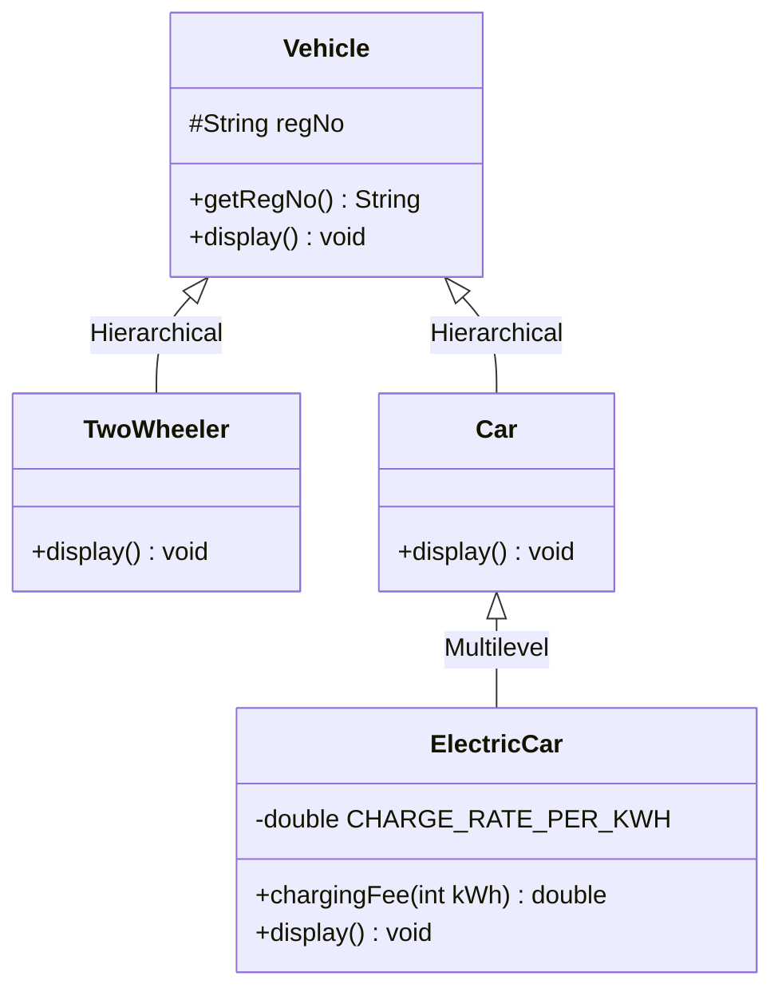

# Task 06: Design the Inheritance Hierarchy

## 1. Inheritance Hierarchy Architecture

The vehicle taxonomy within the Smart-Parking system is structured using hierarchical and multilevel inheritance patterns:



### Hierarchy Breakdown:
1. **Base Superclass (`Vehicle`)**:
   - Isolates the universal state common to all motorized vehicles: `regNo`.
   - Establishes the contract for retrieving registration details.
2. **Hierarchical Inheritance (`Vehicle` $\rightarrow$ `TwoWheeler`, `Vehicle` $\rightarrow$ `Car`)**:
   - Both `TwoWheeler` and `Car` inherit directly from `Vehicle`.
   - They share the registration number logic while categorizing physical space requirements and parking fees.
3. **Multilevel Inheritance (`Vehicle` $\rightarrow$ `Car` $\rightarrow$ `ElectricCar`)**:
   - `ElectricCar` extends `Car`, inheriting both vehicle identity and 4-wheeler dimensions.
   - It introduces new specialized behavior: battery charging and energy fee computation (`chargingFee(int kWh)`).

---

## 2. Constructor Chaining Across Superclasses (`super`)

When a subclass object is instantiated, the superclass constructor **must execute first** to guarantee that inherited private/protected fields are properly initialized:
- `ElectricCar` calls `super(regNo)`, which invokes `Car(regNo)`.
- `Car(regNo)` in turn calls `super(regNo)`, which executes `Vehicle(regNo)`.
- This deterministic order prevents access to uninitialized base state.

---

## 3. Method Overriding and Calling `super.display()`

Subclasses override `display()` to enrich output while delegating common printing to the parent via `super.display()`. This prevents redundant printing code in subclasses.

---

## 4. Why Multiple Inheritance of Classes is Prohibited in Java

Java deliberately disallows multiple class inheritance (`class C extends A, B`) to prevent the **Diamond Problem**:
- If classes `A` and `B` both define a method `void park()` with different implementations, and class `C` inherits from both, the compiler cannot deterministically resolve which implementation `C` should invoke.
- To eliminate ambiguity and memory layout complexities while maintaining flexibility, Java allows a class to inherit from **at most one superclass**, while permitting the implementation of **multiple interfaces** (as explored in Task 09).

---

## 5. Complete Source Code (`InheritanceDemo.java`)

```java
class Vehicle {
    protected final String regNo;

    public Vehicle(String regNo) {
        if (regNo == null || regNo.trim().isEmpty()) {
            throw new IllegalArgumentException("Registration number cannot be empty");
        }
        this.regNo = regNo;
        System.out.println("  [Vehicle Constructor] Initialized base regNo: " + regNo);
    }

    public String getRegNo() { return regNo; }

    public void display() {
        System.out.println("  Registration No : " + regNo);
    }
}

class TwoWheeler extends Vehicle {
    public TwoWheeler(String regNo) {
        super(regNo);
        System.out.println("  [TwoWheeler Constructor] TwoWheeler instantiated");
    }

    @Override
    public void display() {
        super.display();
        System.out.println("  Category        : Two-Wheeler (Motorcycle/Scooter)");
    }
}

class Car extends Vehicle {
    public Car(String regNo) {
        super(regNo);
        System.out.println("  [Car Constructor] Car instantiated");
    }

    @Override
    public void display() {
        super.display();
        System.out.println("  Category        : Four-Wheeler (Car)");
    }
}

class ElectricCar extends Car {
    private static final double CHARGE_RATE_PER_KWH = 12.0;

    public ElectricCar(String regNo) {
        super(regNo);
        System.out.println("  [ElectricCar Constructor] ElectricCar instantiated");
    }

    public double chargingFee(int kWh) {
        if (kWh < 0) {
            throw new IllegalArgumentException("Charging energy cannot be negative");
        }
        return kWh * CHARGE_RATE_PER_KWH;
    }

    @Override
    public void display() {
        super.display();
        System.out.println("  Powertrain      : Electric (EV with charging capability)");
    }
}

public class InheritanceDemo {
    public static void main(String[] args) {
        System.out.println("=== TASK 6: INHERITANCE HIERARCHY DEMO ===\n");

        TwoWheeler bike = new TwoWheeler("TN01A1111");
        bike.display();

        Car car = new Car("TN02B2222");
        car.display();

        ElectricCar ev = new ElectricCar("TN03C3333");
        ev.display();

        System.out.println("\n--- Specialized EV Charging Calculation ---");
        int unitsConsumed = 15;
        double chargingCost = ev.chargingFee(unitsConsumed);
        System.out.println("  Energy Consumed : " + unitsConsumed + " kWh");
        System.out.println("  Charging Rate   : Rs. 12.00 / kWh");
        System.out.println("  Total EV Fee    : Rs. " + chargingCost);
    }
}
```

---

## 6. Execution Output

```text
=== TASK 6: INHERITANCE HIERARCHY DEMO ===

1. Instantiating TwoWheeler (Hierarchical Inheritance):
  [Vehicle Constructor] Initialized base regNo: TN01A1111
  [TwoWheeler Constructor] TwoWheeler instantiated
  Registration No : TN01A1111
  Category        : Two-Wheeler (Motorcycle/Scooter)

2. Instantiating Car (Hierarchical Inheritance):
  [Vehicle Constructor] Initialized base regNo: TN02B2222
  [Car Constructor] Car instantiated
  Registration No : TN02B2222
  Category        : Four-Wheeler (Car)

3. Instantiating ElectricCar (Multilevel Inheritance):
  [Vehicle Constructor] Initialized base regNo: TN03C3333
  [Car Constructor] Car instantiated
  [ElectricCar Constructor] ElectricCar instantiated
  Registration No : TN03C3333
  Category        : Four-Wheeler (Car)
  Powertrain      : Electric (EV with charging capability)

--- Specialized EV Charging Calculation ---
  Energy Consumed : 15 kWh
  Charging Rate   : Rs. 12.00 / kWh
  Total EV Fee    : Rs. 180.0
```
