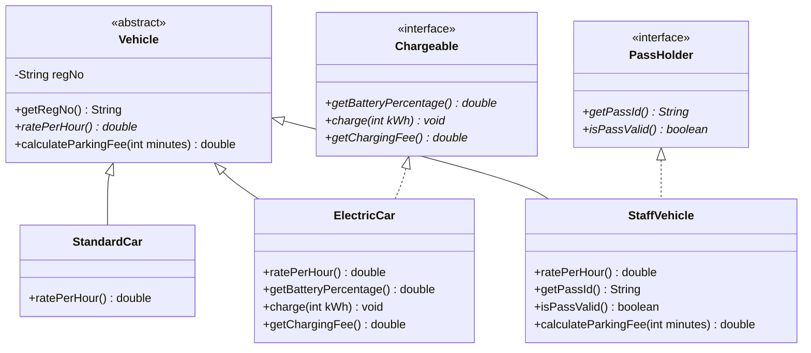

# Task 09: Introduce Abstraction (Abstract Classes vs. Interfaces)

## 1. Abstract Classes vs. Interfaces

Abstraction decouples the contract (what an entity does) from its concrete implementation (how it achieves it).



### Key Differences in Java:

| Feature | Abstract Class (`Vehicle`) | Interface (`Chargeable`, `PassHolder`) |
| :--- | :--- | :--- |
| **Relationship** | **"Is-A"** relationship (e.g., `Car` *is a* `Vehicle`). | **"Can-Do"** / Capability contract (e.g., `ElectricCar` *can charge*). |
| **State & Instance Fields** | Can maintain mutable or immutable instance variables (`regNo`). | Only supports `public static final` constants. |
| **Constructors** | Has constructors executed via `super()` during subclass initialization. | Cannot have constructors. |
| **Inheritance Multiplicity** | Single class inheritance only (`extends Vehicle`). | Multiple interface implementation (`implements Chargeable, PassHolder`). |
| **Code Reuse** | Provides template methods with shared logic (`calculateParkingFee`). | Specifies pure behavior (or `default` helper methods). |

---

## 2. Why Capability Interfaces Enable Safe Future Extensions

If charging were forced into the abstract class `Vehicle`, non-electric vehicles (petrol cars, bicycles) would inherit useless methods like `charge()`, violating the **Interface Segregation Principle (ISP)**.

By defining `Chargeable` as an independent interface:
- Any future electric device—such as an `ElectricBike`, a campus `ElectricShuttleBus`, or even facility battery backup units—can implement `Chargeable` without forcing an unnatural inheritance relationship with passenger vehicles.

---

## 3. Complete Implementation (`AbstractionDemo.java`)

```java
interface Chargeable {
    double CHARGING_RATE_PER_KWH = 12.0;

    double getBatteryPercentage();
    void charge(int kWh);
    double getChargingFee();
}

interface PassHolder {
    String getPassId();
    boolean isPassValid();
}

abstract class Vehicle {
    private final String regNo;

    protected Vehicle(String regNo) {
        if (regNo == null || regNo.trim().isEmpty()) {
            throw new IllegalArgumentException("Registration cannot be empty");
        }
        this.regNo = regNo;
    }

    public String getRegNo() { return regNo; }

    public abstract double ratePerHour();

    public double calculateParkingFee(int minutes) {
        int billableHours = (minutes + 59) / 60;
        return billableHours * ratePerHour();
    }
}

class StandardCar extends Vehicle {
    public StandardCar(String regNo) { super(regNo); }

    @Override
    public double ratePerHour() { return 30.0; }
}

class ElectricCar extends Vehicle implements Chargeable {
    private double batteryLevel;
    private int energyConsumed;

    public ElectricCar(String regNo, double initialBattery) {
        super(regNo);
        this.batteryLevel = initialBattery;
        this.energyConsumed = 0;
    }

    @Override
    public double ratePerHour() { return 35.0; }

    @Override
    public double getBatteryPercentage() { return batteryLevel; }

    @Override
    public void charge(int kWh) {
        this.energyConsumed += kWh;
        this.batteryLevel = Math.min(100.0, this.batteryLevel + (kWh * 2.5));
    }

    @Override
    public double getChargingFee() {
        return energyConsumed * CHARGING_RATE_PER_KWH;
    }
}

class StaffVehicle extends Vehicle implements PassHolder {
    private final String passId;
    private final boolean active;

    public StaffVehicle(String regNo, String passId, boolean active) {
        super(regNo);
        this.passId = passId;
        this.active = active;
    }

    @Override
    public double ratePerHour() { return 30.0; }

    @Override
    public String getPassId() { return passId; }

    @Override
    public boolean isPassValid() { return active; }

    @Override
    public double calculateParkingFee(int minutes) {
        if (isPassValid()) {
            return 0.0;
        }
        return super.calculateParkingFee(minutes);
    }
}

public class AbstractionDemo {
    public static void main(String[] args) {
        System.out.println("=== TASK 9: ABSTRACTION VIA ABSTRACT CLASSES & INTERFACES ===\n");

        Vehicle[] fleet = {
            new StandardCar("TN01AA1000"),
            new ElectricCar("TN02BB2000", 35.0),
            new StaffVehicle("TN03CC3000", "PASS-STAFF-99", true)
        };

        int parkedMinutes = 120; // 2 hours

        for (Vehicle v : fleet) {
            System.out.println("Vehicle: " + v.getRegNo() + " (" + v.getClass().getSimpleName() + ")");
            
            if (v instanceof Chargeable ev) {
                System.out.println("  -> Initial Battery: " + ev.getBatteryPercentage() + "%");
                ev.charge(12);
                System.out.println("  -> Battery after charging: " + ev.getBatteryPercentage() + "%");
                System.out.printf("  -> EV Charging Cost: Rs. %.2f%n", ev.getChargingFee());
            }

            if (v instanceof PassHolder ph) {
                System.out.println("  -> Monthly Pass: " + ph.getPassId() + " (Valid: " + ph.isPassValid() + ")");
            }

            double parkingFee = v.calculateParkingFee(parkedMinutes);
            System.out.printf("  -> Net Parking Fee: Rs. %.2f%n%n", parkingFee);
        }
    }
}
```

---

## 4. Execution Output

```text
=== TASK 9: ABSTRACTION VIA ABSTRACT CLASSES & INTERFACES ===

Vehicle: TN01AA1000 (StandardCar)
  -> Net Parking Fee: Rs. 60.00

Vehicle: TN02BB2000 (ElectricCar)
  -> Initial Battery: 35.0%
  -> Battery after charging: 65.0%
  -> EV Charging Cost: Rs. 144.00
  -> Net Parking Fee: Rs. 70.00

Vehicle: TN03CC3000 (StaffVehicle)
  -> Monthly Pass: PASS-STAFF-99 (Valid: true)
  -> Net Parking Fee: Rs. 0.00
```
