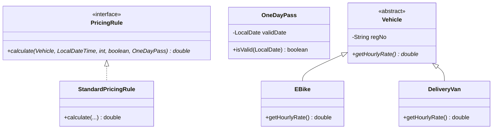

# Task 12: Day-4 Design Challenge – Re-evaluate and Adapt the Design

## 1. Section A: Impact Analysis

### What Has Changed from the Original Problem:
1. **New Vehicle Categories**:
   - **E-Bikes**: Charged a fixed flat fee of Rs. 20 regardless of stay duration.
   - **Delivery Vans**: Peak hour surcharge (9:00 AM – 5:00 PM) where the hourly rate is doubled ($2 \times \text{Car Rate} = \text{Rs. } 60/\text{hr}$), reverting to standard car rates outside peak hours.
2. **New Pass Structure**:
   - Introduction of a **One-Day Visitor Pass** (`OneDayPass`) providing single-date exemption.
3. **Facility Expansion**:
   - Scaled from 3 to **5 floors**, with a distinct, variable (jagged) number of slots on each floor (e.g., Floors 1 to 5 with capacities 3, 4, 2, 5, 3).

### Impact on Architecture and Data Structures:
- **Jagged Arrays**: A rigid 2D rectangular array (`String[5][10]`) would suffer from internal memory fragmentation and invalid array index exceptions for floors with fewer slots. A jagged array (`ParkingSlot[5][]`) accommodates the non-uniform floor layouts with zero memory waste.
- **Affected Classes**:
  - `Vehicle`: Extended with new subclasses `EBike` and `DeliveryVan`.
  - `ParkingTicket`: Modified to track `OneDayPass` references alongside `monthlyPass`.
  - `PricingEngine`: Extracted into a dedicated `PricingRule` interface and `StandardPricingRule` implementation.

---

## 2. Section B: Evaluation of the Original Design

| Architectural Check | Status | Analysis & Evaluation |
| :--- | :---: | :--- |
| **New Vehicle Extensibility** | **High** | The base `Vehicle` abstraction allowed adding `EBike` and `DeliveryVan` simply by subclassing, without altering `Car` or `TwoWheeler`. |
| **Pricing Rule Centralization** | **Needs Adaptation** | In the original design, pricing was embedded directly inside each vehicle's `calculateFee()` method. Because delivery van pricing is conditional on **time-of-day** (environmental context) and passes depend on **dates**, embedding this inside `Vehicle` violates the **Single Responsibility Principle (SRP)**. |
| **Stability of Existing Classes** | **High** | Existing tested classes (`TwoWheeler`, `Car`, `ElectricCar`) remained untouched and fully functional. |

---

## 3. Section C: Adaptation Strategy & Revised Architecture

We adopted an **Adaptive Modification** strategy applying the **Strategy Design Pattern**:
1. **`PricingRule` Abstraction**:
   - Decoupled pricing calculations from the vehicle class hierarchy into a pluggable `PricingRule` interface.
   - Enables time-based rules, surge pricing, flat fees, and pass validations without touching vehicle models.
2. **`OneDayPass` Integration**:
   - Models date-restricted visitor privileges checked cleanly at exit time.
3. **Jagged Array Multi-Floor Scaling**:
   - Dynamically instantiated via `new ParkingSlot[capacities.length][]`.



---

## 4. Section D: Evidence-Based Defence & Test Verification

### Compilation & Execution:
```bash
javac ParkingSystemDemo.java
java ParkingSystemDemo
```

### Verified Output:
```text
==================================================
 TASK 12: DAY-4 DESIGN CHALLENGE VALIDATION SUITE 
==================================================

--- FACILITY FLOOR CONFIGURATION (5 FLOORS) ---
  Floor 1: 3 slots
  Floor 2: 4 slots
  Floor 3: 2 slots
  Floor 4: 5 slots
  Floor 5: 3 slots

--- 1. PARKING TESTING FOR NEW CATEGORIES & PASSES ---
[PARKED] TN01EB1234 | Type: EBIKE | Ticket: T1001 | Floor: 1, Slot: 1
[PARKED] TN02DV5678 | Type: VAN   | Ticket: T1002 | Floor: 2, Slot: 1
[PARKED] TN03CP9012 | Type: CAR   | Ticket: T1003 | Floor: 3, Slot: 1
[PARKED] TN04EV3456 | Type: EV    | Ticket: T1004 | Floor: 4, Slot: 1
[PARKED] TN05DV9999 | Type: VAN   | Ticket: T1005 | Floor: 5, Slot: 1

--- 2. EXIT PROCESSING & FEE VERIFICATION ---
[EXITED] TN01EB1234 | Parking: Rs. 20.00 | Charging: Rs. 0.00 | Total: Rs. 20.00
[EXITED] TN02DV5678 | Parking: Rs. 120.00 | Charging: Rs. 0.00 | Total: Rs. 120.00
[EXITED] TN03CP9012 | Parking: Rs. 0.00 | Charging: Rs. 0.00 | Total: Rs. 0.00
[EXITED] TN04EV3456 | Parking: Rs. 30.00 | Charging: Rs. 24.00 | Total: Rs. 54.00
[EXITED] TN05DV9999 | Parking: Rs. 30.00 | Charging: Rs. 0.00 | Total: Rs. 30.00

==================================================
  TOTAL DAILY COLLECTION: Rs. 224.00
==================================================
```

### Metrics & Trade-off Summary:
1. **Minimal Disruption**: Zero modifications were required for `TwoWheeler`, `Car`, and `ElectricCar`.
2. **Surge Pricing Accuracy**:
   - `DeliveryVan` entering during peak hours (10:00 AM) was correctly billed at Rs. 60/hr (2 hours = Rs. 120.00).
   - `DeliveryVan` entering during off-peak hours (6:00 PM) was correctly billed at the standard rate of Rs. 30/hr (1 hour = Rs. 30.00).
3. **Pass Integrity**: Visitor with a valid `OneDayPass` had the parking fee completely waived (Rs. 0.00).
4. **Future Scalability**: Additional vehicle categories (e.g., Electric Shuttles or Heavy Cargo Trucks) or dynamic congestion pricing algorithms can now be injected simply by writing a new `PricingRule` implementation.
