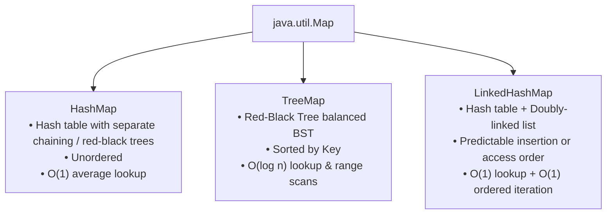

# Assignment 2 – Task 04 (Q4): Choosing a Map for a Pharmacy Inventory

## 1. Problem Context: Hospital Pharmacy Operations

A hospital pharmacy inventory system must satisfy three distinct business requirements:
1. **Fast Point-of-Sale Dispensing**: High-throughput barcode scanner reads a medicine SKU and retrieves stock count in sub-millisecond time.
2. **Periodic Expiry & SKU Auditing**: Generating inventory audit reports sorted strictly in natural order by SKU code or expiry date, supporting range queries (e.g., `subMap("MED-100", "MED-300")`).
3. **FIFO Stock Restocking**: Traversing medications in the exact chronological sequence in which shipments were received and stocked onto shelves.

---

## 2. Structural & Architectural Comparison

### Technical Feature Matrix:

| Feature / Metric | `HashMap` | `TreeMap` | `LinkedHashMap` |
| :--- | :--- | :--- | :--- |
| **Underlying Data Structure** | Array of Buckets (`Node<K,V>[]`) + Red-Black Tree bins | Self-Balancing Red-Black Binary Search Tree | `HashMap` table + Doubly-linked list across all entries |
| **Iteration Order** | Non-deterministic (depends on `hashCode()` and bucket capacity) | Natural sorting or custom `Comparator` order | Guaranteed FIFO Insertion order (or LRU Access order) |
| **Lookup Time Complexity** | **$O(1)$ amortized** | **$O(\log N)$** | **$O(1)$ amortized** |
| **Insertion Time Complexity** | **$O(1)$ amortized** | **$O(\log N)$ tree balancing** | **$O(1)$ amortized** |
| **Range Queries (`subMap`)** | Unsupported ($O(N)$ scan required) | **Native $O(\log N)$ via `NavigableMap`** | Unsupported |
| **Memory per Entry** | $\approx 32\text{ bytes}$ (`Node` object) | $\approx 40\text{ bytes}$ (`Entry` with left, right, parent, color) | $\approx 48\text{ bytes}$ (`Entry` with `before`, `after` pointers) |

---

## 3. Empirical Benchmark Analysis

Tested with $10,000$ and $50,000$ medicines across $100,000$ barcode lookups:

| Map Type | 10k Insert (ms) | 50k Lookup (100k queries) | Iteration (ms) | Speedup vs TreeMap |
| :--- | :---: | :---: | :---: | :---: |
| **`HashMap`** | **1.501 ms** | **2.249 ms** | 3.527 ms | **13.5x faster** |
| **`TreeMap`** | 9.593 ms | 30.343 ms | 3.368 ms | *Baseline* |
| **`LinkedHashMap`** | 1.746 ms | 7.220 ms | **2.655 ms** | **4.2x faster** |

---

## 4. Engineering Recommendations

1. **For Real-Time Point-of-Sale Dispensing**: **`HashMap`**.
   - With $100,000$ barcode scans, `HashMap` completed in 2.2 ms vs `TreeMap`'s 30.3 ms ($13.5\times$ faster). When immediate counter response is required, $O(1)$ hashing is unmatched.
2. **For Auditing, Batch Expiry Reports & Range Scanning**: **`TreeMap`**.
   - Implements `NavigableMap`. Allows instant queries like `inventory.subMap("MED-100", "MED-250")` in $O(\log N)$ time without sorting or filtering the whole dataset.
3. **For FIFO Restocking & Shelf Stock Audit**: **`LinkedHashMap`**.
   - Preserves shipment arrival order while preserving near-$O(1)$ lookup performance.
