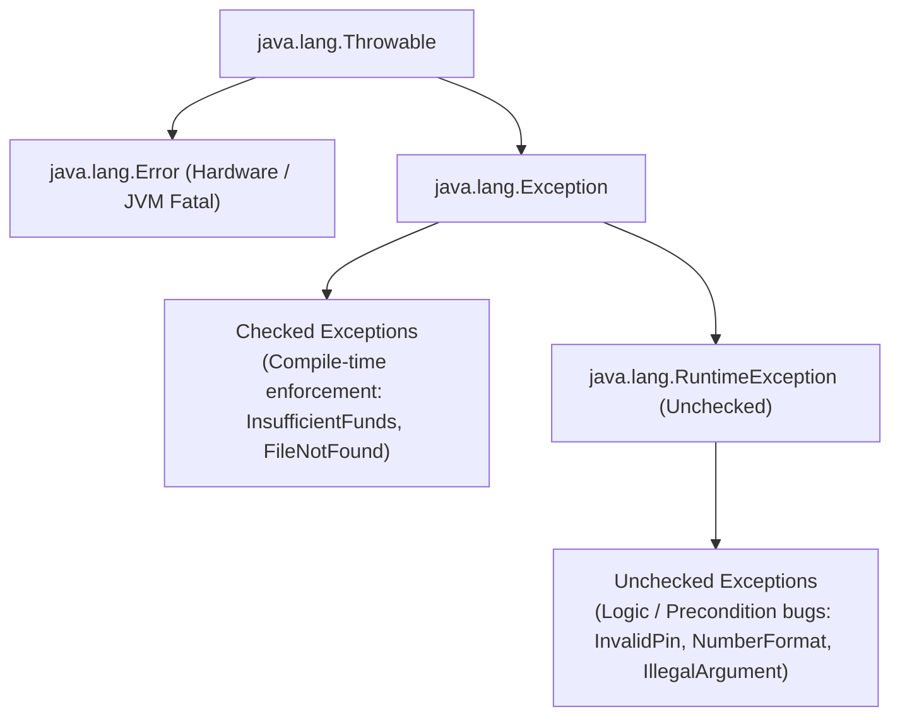

# Assignment 3 – Task 01 (Q1): Handling Failure in a Bank ATM Simulation

## 1. Problem Context: Fault Tolerance in Banking Terminals

An Automated Teller Machine (ATM) is a mission-critical, hardware-integrated transactional kiosk. A transaction involves multiple points of failure:
- Missing hardware device/card file (`FileNotFoundException`).
- Security authentication rejection (`InvalidPinException`).
- Insufficient account funds (`InsufficientFundsException`).
- Malformed alphanumeric input typed by user (`NumberFormatException`).
- Negative withdrawal amounts or invalid machine states (`IllegalArgumentException`, `IllegalStateException`).

### The Critical Invariant:
Regardless of whether a transaction succeeds or fails midway through any of these exceptions, **the user's physical ATM card must never remain trapped inside the machine**.

---

## 2. Checked vs. Unchecked Exceptions Taxonomy



| Exception Type | Subclass Of | Checked by Compiler? | Purpose in ATM Architecture |
| :--- | :--- | :---: | :--- |
| **`InsufficientFundsException`** | `java.lang.Exception` | **Yes** | **Checked**: Anticipated business failure. The calling ATM workflow must explicitly catch it and prompt the user to request a lower amount. |
| **`FileNotFoundException`** | `java.io.IOException` | **Yes** | **Checked**: External environmental fault (card reader communication failure). Requires hardware fallback. |
| **`InvalidPinException`** | `java.lang.RuntimeException` | **No** | **Unchecked**: Authentication precondition violation. Triggers card lockout or retry count tracking. |
| **`NumberFormatException`** | `java.lang.IllegalArgumentException` | **No** | **Unchecked**: Input sanitation failure when parsing user input strings to numeric currency values. |

---

## 3. The Guaranteed Cleanup Contract: `finally` Block

In Java:
```java
try {
    atm.insertCard(cardFile);
    atm.authenticate(pin);
    atm.withdraw(amount);
} catch (Exception e) {
    // Logging and handling
} finally {
    atm.ejectCard(); // ALWAYS EXECUTES!
}
```
- Even if an exception is thrown on line 1, 2, or 3, the runtime guarantees execution of `finally` before unwinding the stack.
- This prevents physical card loss and releases database transaction locks.

---

## 4. Alternative Concept: Exceptions vs. C-Style Error Return Codes

| Dimension | Java Exception Handling | C-Style Integer Error Codes |
| :--- | :--- | :--- |
| **Call Site Cleanliness** | Business logic is cleanly separated in `try` from error remediation in `catch`. | Every single statement requires immediate conditional checking: `if (code != SUCCESS) return code;`. |
| **Enforcement** | Checked exceptions **force** the developer to handle failure at compile time. | Error codes can be silently ignored by lazy callers, leading to silent database corruption. |
| **Diagnostic Context** | Carries a rich stack trace, causality chain, and custom fields (e.g., `getDeficit()`). | Typically provides only an integer constant (e.g., `-1`, `ERR_3`), losing stack context. |
| **Performance Overhead** | Throwing creates a stack trace snapshot ($O(\text{stack depth})$ overhead). Best suited for exceptional conditions. | Negligible CPU register return cost ($O(1)$). |

### Verdict:
For banking operations where financial data integrity, security auditing, and mandatory error handling outweigh microsecond CPU differences, **Exceptions are mandatory**.
