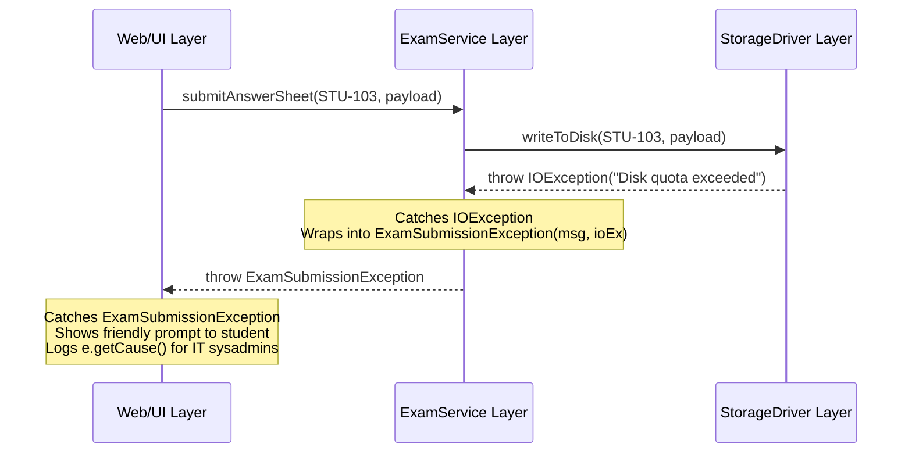

# Assignment 3 – Task 02 (Q2): User-Defined Exceptions and Propagation

## 1. Problem Context: Online Examination Portal

In an academic examination portal, thousands of students simultaneously upload answer PDFs. Errors can occur across three architectural layers:
1. **Low-level Infrastructure Layer**: Storage quota limits, disk faults, or database timeouts (`IOException`, `SQLException`).
2. **Business / Service Layer**: Exam submission policies, grading deadlines, and session management.
3. **UI / Presentation Layer**: Displays student-friendly error prompts.

If a raw `IOException` (e.g., `Disk write error at sector 0x4B`) leaks directly to the user interface, it exposes internal server infrastructure (a security vulnerability) and confuses the student. Conversely, if the exception is swallowed or replaced without recording the cause, system engineers cannot diagnose why the upload failed.

---

## 2. Exception Chaining & Root Cause Preservation

Exception chaining solves this dilemma by wrapping a low-level technical exception into a domain-specific exception while passing the original exception to the constructor:

```java
try {
    StorageDriver.writeToDisk(fileName, sizeKb);
} catch (IOException e) {
    // Wrapped into SubmissionStorageException; original 'e' preserved as root cause
    throw new SubmissionStorageException("Could not store " + fileName, e);
}
```

### What Happens if `cause` is Omitted?
If the constructor `new SubmissionStorageException("Could not store " + fileName)` is invoked without passing `e`:
- `e.getCause()` returns `null`.
- The `NullPointerException` risk occurs if client code queries `e.getCause().getMessage()`.
- The original stack trace identifying the disk sector or network socket is permanently lost from telemetry logs.

---

## 3. "Complete the Code" Implementation (`StorageDemo.java`)

```java
import java.io.IOException;

class ExamException extends Exception {
    ExamException(String message) { super(message); }
    ExamException(String message, Throwable cause) { super(message, cause); }
}

class SubmissionStorageException extends ExamException {
    SubmissionStorageException(String message, Throwable cause) {
        super(message, cause);
    }
}

class Storage {
    void save(String fileName, long sizeKb) throws SubmissionStorageException {
        try {
            if (sizeKb > 500) {
                throw new IOException("Disk quota exceeded");
            }
            System.out.println("Saved " + fileName);
        } catch (IOException e) {
            // TODO 1: Wrap the IOException in a SubmissionStorageException, keeping IOException as cause
            throw new SubmissionStorageException("Could not store " + fileName, e);
        }
    }
}

public class StorageDemo {
    public static void main(String[] args) {
        Storage storage = new Storage();
        try {
            storage.save("answer01.pdf", 120);
            storage.save("answer02.pdf", 800);
        } catch (ExamException e) {
            System.out.println("Error: " + e.getMessage());
            System.out.println("Cause: " + e.getCause().getMessage());
        }
    }
}
```

### Verified Terminal Output:
```text
Saved answer01.pdf
Error: Could not store answer02.pdf
Cause: Disk quota exceeded
```

---

## 4. Multi-Tiered Propagation Architecture (`ExamPortalPropagation.java`)



1. **Information Hiding**: The UI shows a clear, actionable message to the student (`"Unable to process exam submission for STU-103"`).
2. **Operational Observability**: IT administrators inspect `e.getCause()`, observing the exact underlying error (`"Remote storage server disk write failed: ErrorCode 507 - Insufficient Storage"`).
3. **Domain Cohesion**: All application-specific errors extend `ExamException`, allowing higher layers to catch high-level domain faults uniformly.
