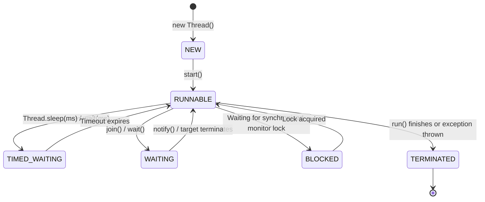

# Assignment 3 – Task 04 (Q4): Thread Creation and the Thread Life Cycle

## 1. Problem Context: Multi-Counter Baggage Scanner Station

In an airport baggage terminal, multiple scanner stations process luggage conveyors concurrently. Each scanning belt runs as an independent concurrent execution flow. We model and inspect:
1. Thread instantiation strategies (`Thread` subclassing vs. `Runnable` implementation).
2. The complete 6-state JVM Thread Life Cycle (`Thread.State`).
3. Thread coordination via `join()`, `setPriority()`, and `interrupt()`.

---

## 2. Comparing Thread Creation Paradigms

| Architectural Criterion | Extending `java.lang.Thread` | Implementing `java.lang.Runnable` (Recommended) |
| :--- | :--- | :--- |
| **Class Inheritance Constraints** | Java permits single class inheritance only. If a station class extends `Thread`, it **cannot extend any other domain class** (e.g., `ConveyorHardware`). | The class can extend any domain superclass while implementing `Runnable`, preserving architectural flexibility. |
| **Separation of Concerns** | Tightly couples the task code (`run()`) with the underlying operating system thread execution vehicle. | Strictly decouples the **Task (What to do)** from the **Worker (Who executes it)**. |
| **Executor / ThreadPool Reuse** | Incompatible with thread pools; creating a new `Thread` instance spawns a heavyweight OS thread every time. | `Runnable` instances can be submitted directly to `ExecutorService`, `ThreadPoolExecutor`, and `ForkJoinPool`. |

---

## 3. The 6 JVM Thread Life Cycle States



### Empirical State Transitions Observed in Simulation:
1. **`NEW`**: Created object via `new StationThread()`. `isAlive() == false`.
2. **`RUNNABLE`**: Invoked `scannerA.start()`. OS native thread allocated; eligible for CPU core scheduling.
3. **`TIMED_WAITING`**: Thread invoked `Thread.sleep(15)`. Relinquished CPU slice for fixed duration without releasing monitor locks.
4. **`WAITING`**: Main thread invoked `scannerA.join()`, pausing until `scannerA` finished.
5. **`TERMINATED`**: `run()` method exited. Heap thread object remains for metrics, but OS thread is dismantled.

---

## 4. Cooperative Interruption Architecture

In modern Java, threads must never be forcefully killed via deprecated methods like `Thread.stop()` (which causes corrupted object locks). Instead, Java uses **cooperative interruption**:
- An external controller signals `thread.interrupt()`.
- If blocked in `Thread.sleep()` or `wait()`, an `InterruptedException` is thrown immediately.
- The thread catches the exception, closes conveyor belts, flushes buffers, and terminates cleanly:
  ```java
  } catch (InterruptedException e) {
      System.out.println("Interrupted! Clean task shutdown.");
      Thread.currentThread().interrupt(); // Best practice: restore interrupt status
  }
  ```
