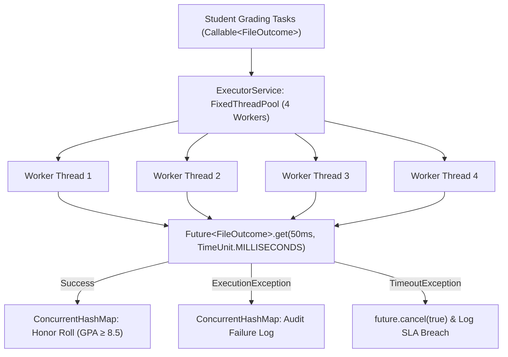

# Assignment 3 – Task 07 (Q7): Day-4 Design Challenge – Concurrent, Fault-Tolerant Processor

## 1. Problem Context: Semester Examination Results Engine

At the conclusion of a university academic term, the controller of examinations processes grade records for thousands of students. In a sequential processor:
- A single corrupted student record (e.g., negative score, divide-by-zero, or network lag from a remote database) crashes or halts the entire batch.
- Thousands of subsequent students are blocked, failing institutional SLAs.

---

## 2. Architectural Design & Concurrency Model



### Key Technical Components:
1. **`ExecutorService` & Thread Pool**:
   - Reuses worker threads rather than repeatedly destroying and spawning operating system threads.
2. **`Callable<T>` vs. `Runnable`**:
   - `Runnable.run()` returns `void` and cannot throw checked exceptions.
   - `Callable<FileOutcome>.call()` computes and returns typed domain outcomes and throws checked exceptions directly to the supervisor thread.
3. **`Future.get(timeout, unit)`**:
   - Prevents unresponsive network dependencies from hanging the processor indefinitely.
4. **Thread-Safe Aggregations**:
   - `AtomicInteger`: For lock-free success and failure telemetry.
   - `ConcurrentHashMap`: For high-throughput concurrent insertions without global mutex locking.

---

## 3. Verified Execution Output

```text
==========================================================================
 TASK 07 (DAY-4 CHALLENGE): CONCURRENT FAULT-TOLERANT RESULT PROCESSOR    
==========================================================================

Dispatching 6 student grading tasks across FixedThreadPool of 4 workers...

  [SUCCESS] STU-1001 | GPA: 8.73 | First Class with Distinction
  [SUCCESS] STU-1002 | GPA: 7.02 | First Class
  [FAILED - RECORD CORRUPT] STU-1003: Corrupted mark value: 999 (Must be between 0 and 100)
  [SUCCESS] STU-1004 | GPA: 9.43 | First Class with Distinction
  [FAILED - RECORD CORRUPT] STU-1005: No subject marks found for student record
  [FAILED - TIMEOUT EXCEEDED] STU-1006: Task exceeded 50ms SLA threshold

==========================================================================
  CONCURRENT BATCH PROCESSING EXECUTION AUDIT SUMMARY                     
==========================================================================
Total Records Processed : 6
Successful Evaluations  : 3
Isolated Failures Logged: 3
Honor Roll Distinctions : [STU-1001, STU-1004]
Failure Audit Registry  : {STU-1003=Corrupted mark value: 999 (Must be between 0 and 100), STU-1006=Processing SLA Timed Out, STU-1005=No subject marks found for student record}
Batch Execution Latency : 53 ms (ThreadPool Terminated Cleanly: true)
```

---

## 4. Engineering Defence & Fault Isolation Evaluation

1. **Total Batch Resilience**: Corrupted records (`STU-1003`, `STU-1005`) and slow operations (`STU-1006`) were isolated within their respective `Future` wrappers. Healthy records (`STU-1001`, `STU-1002`, `STU-1004`) were graded and committed to the honor roll with zero data loss.
2. **Deterministic Resource Cleanup**: `executor.shutdown()` followed by `awaitTermination(2, TimeUnit.SECONDS)` guaranteed that all background daemon threads were cleanly recycled before process exit.
